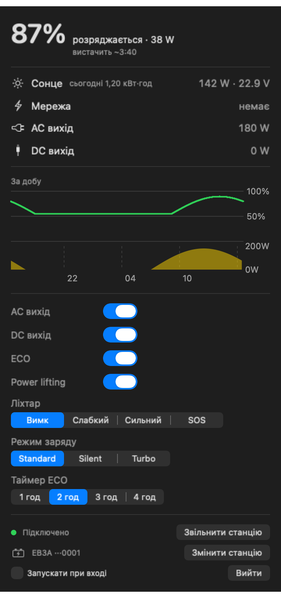
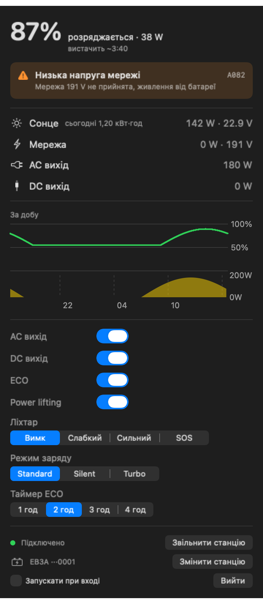
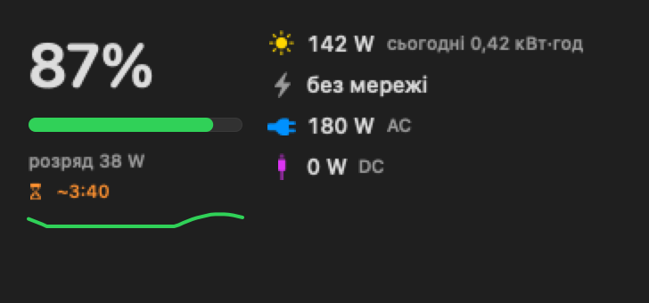
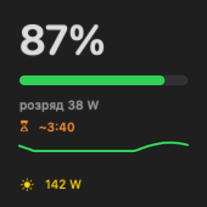
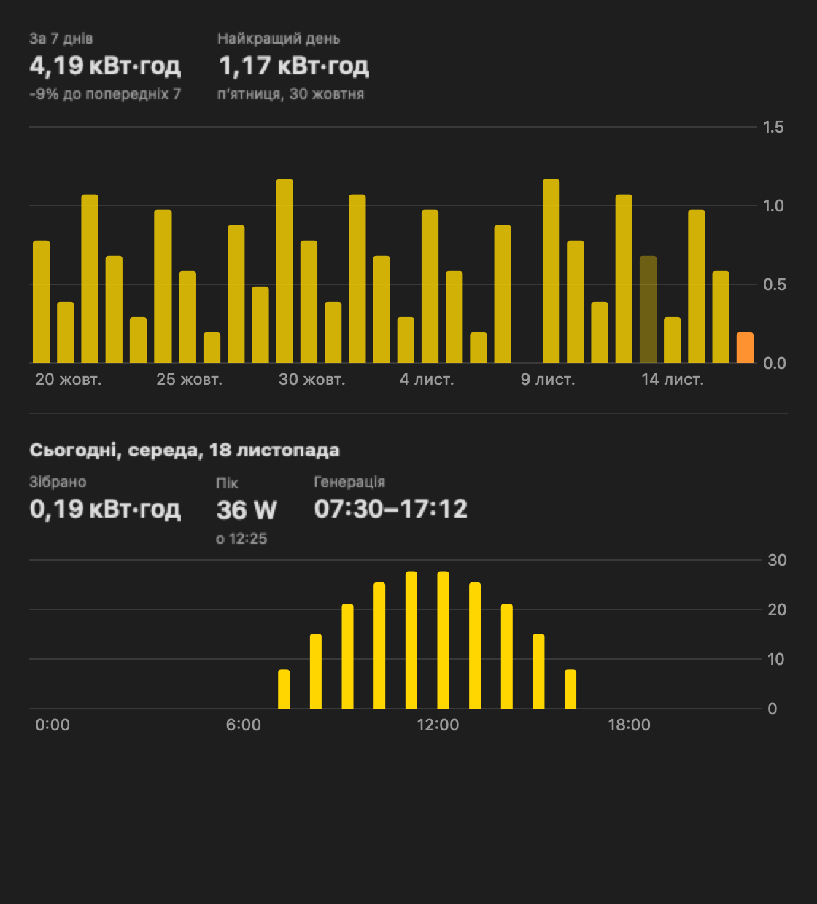
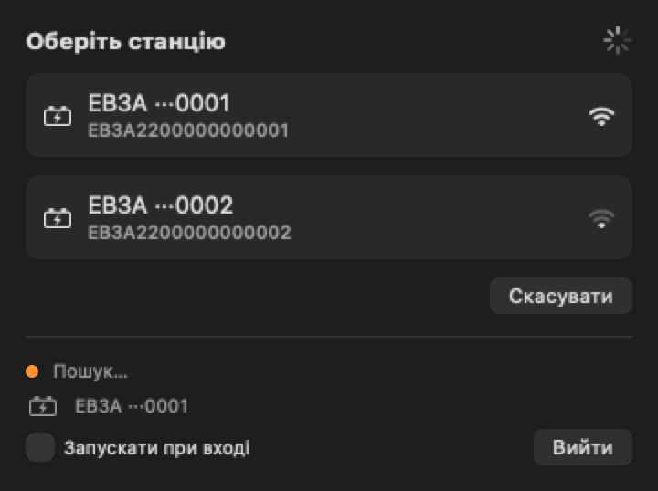

# EB3A Monitor

Неофіційний застосунок для macOS, який показує стан зарядної станції **Bluetti EB3A** в рядку меню і віджеті та керує нею через Bluetooth. Без хмари й без телефону.

*Unofficial macOS menu bar app and widget for the Bluetti EB3A power station over Bluetooth LE (Modbus over BLE, no cloud). UI is in Ukrainian; the register map in [REGISTERS.md](REGISTERS.md) is useful for any EB3A integration.*

<p>
  
  
</p>
<p>
  
  
</p>

## Можливості

- **Рядок меню**: `⚡ ☀ 142W  🔋 87%`. ⚡ означає, що є мережа, ☀ показує потужність від панелі, а `⚠️` з'являється, коли станція подає сигнал.
- **Поповер**:
  - заряд і стан (заряд, розряд, pass-through) з прогнозом автономності;
  - сонце (W, V, кВт·год за сьогодні), мережа, виходи;
  - графік заряду й сонця за добу;
  - сигнали станції з кодами офіційного додатку (наприклад, `A082` «Низька напруга мережі»);
  - керування: AC/DC, ліхтар, режим заряду (Standard/Silent/Turbo), ECO з таймером, power lifting.
- **Віджет** (small і medium): заряд, джерела живлення, енергія сонця за день, сигнали.
- **Статистика сонця** (кнопка біля «Сонце»): кВт·год по днях за 30 днів, тиждень до тижня, найкращий день, пік, вікно генерації й погодинний профіль будь-якого дня.
- **Історія**: хвилинні записи за 7 днів, денні підсумки сонця за 90.
- **Кілька станцій**: «Змінити станцію» відкриває список EB3A поблизу.
- **Автопідключення**: після сну Mac, вимкнення Bluetooth і втрати зв'язку застосунок перепідключається сам. «Звільнити станцію» тимчасово віддає з'єднання офіційному додатку.

<p>
  
  
</p>

## Встановлення

Потрібно: macOS 26+, Xcode, [XcodeGen](https://github.com/yonaskolb/XcodeGen) (`brew install xcodegen`), Apple ID в Xcode (безкоштовна Personal Team підходить).

1. Дізнайся свій Team ID: Xcode → Settings → Accounts → твоя команда. Або в терміналі: `security find-certificate -c "Apple Development" -p | openssl x509 -noout -subject`, поле `OU`.
2. Запиши його в локальний файл (у git він не потрапляє):
   ```bash
   echo XXXXXXXXXX > mac/team.local
   ```
3. Збери й встанови:
   ```bash
   ./install.sh
   ```
   Скрипт збирає Release, кладе `EB3AMonitor.app` у `/Applications` і запускає. Повторний запуск оновлює застосунок.

Під час першого запуску дозволь доступ до Bluetooth. Застосунок сам знайде EB3A поблизу. Віджет додається так: ПКМ на робочому столі → «Змінити віджети» → EB3A. Автозапуск вмикається галочкою в поповері.

> Зв'язок з EB3A буває лише один: поки підключений застосунок, офіційний додаток Bluetti не підключиться. Для цього є кнопка «Звільнити станцію».

## Як це працює

EB3A говорить **Modbus RTU поверх BLE** (сервіс `FF00`, запис у `FF02`, відповіді в `FF01`). На прошивці ARM 2063.03 / DSP 2052.11 шифрування немає. Застосунок читає регістри дрібними блоками (великі блоки станція віддає за ~3 с) і пише лише перевірені регістри зі списку дозволених.

Повна карта регістрів зі статусом перевірки кожного поля лежить у **[REGISTERS.md](REGISTERS.md)**. Там є телеметрія, керування, біти сигналів (A082 тощо), годинник і таймінги. Окремо зазначено, чого EB3A по BLE **не віддає**: напруги комірок, температури, частоти. Це підтверджено BLE-логом офіційного додатку.

Структура:

| Шлях | Що |
|---|---|
| `mac/EB3AKit` | протокол і логіка (Swift package, тести `swift test --package-path mac/EB3AKit`) |
| `mac/EB3AMonitor` | застосунок у рядку меню (SwiftUI + CoreBluetooth) |
| `mac/EB3AWidget` | віджет WidgetKit |
| `mac/tools/icon.swift` | генератор іконки |
| `*.py`, `live.html` | дослідницькі інструменти (нижче) |
| `docs/superpowers` | дизайн і план реалізації |

Логи застосунку:
```bash
/usr/bin/log stream --predicate 'subsystem == "com.legion.eb3amonitor"'
```

`./snapshot.sh out.png` рендерить поповер у PNG (потрібна debug-збірка; змінні `SNAP_ALERT`, `SNAP_PICKER`, `SNAP_WIDGET=small|medium`).

## Дослідницькі інструменти (Python)

З ними розбирали протокол. Запускати з Terminal (потрібен доступ до Bluetooth). Перед цим звільни станцію.

```bash
python3 -m venv .venv && .venv/bin/pip install -r requirements.txt
.venv/bin/bluetti-scan -s 10               # знайти станцію (на macOS адреса це UUID)
export EB3A_ADDRESS=<UUID>
.venv/bin/python probe.py $EB3A_ADDRESS    # сирі кадри, перевірка шифрування
.venv/bin/python snap.py take before       # знімок усіх живих регістрів
.venv/bin/python snap.py diff before after # що змінилося
.venv/bin/python live.py                   # live-панель на http://127.0.0.1:8765
.venv/bin/python pklg_modbus.py trace.pklg # Modbus-кадри з BLE-логу iPhone (PacketLogger)
```

`live.py` має сирі запити, скан діапазонів і керування з білим списком регістрів.

## Застереження

Проєкт неофіційний і **не пов'язаний з BLUETTI**. Застосунок записує налаштування в пристрій, тож використовуєш його на власний ризик. Запис обмежено регістрами, перевіреними на реальній EB3A. Вимкнення станції, OTA та невідомі регістри заблоковано в коді.

## Подяки

Знання про протокол частково взято з відкритих проєктів:
- [Patrick762/bluetti-bt-lib](https://github.com/Patrick762/bluetti-bt-lib)
- [warhammerkid/bluetti_mqtt](https://github.com/warhammerkid/bluetti_mqtt)
- [giovanne123/EB3A_Bluetti_ESP32_HA](https://github.com/giovanne123/EB3A_Bluetti_ESP32_HA)
- [HexRevEX/bluetti_EB3A_client](https://github.com/HexRevEX/bluetti_EB3A_client)

## Ліцензія

[MIT](LICENSE)
